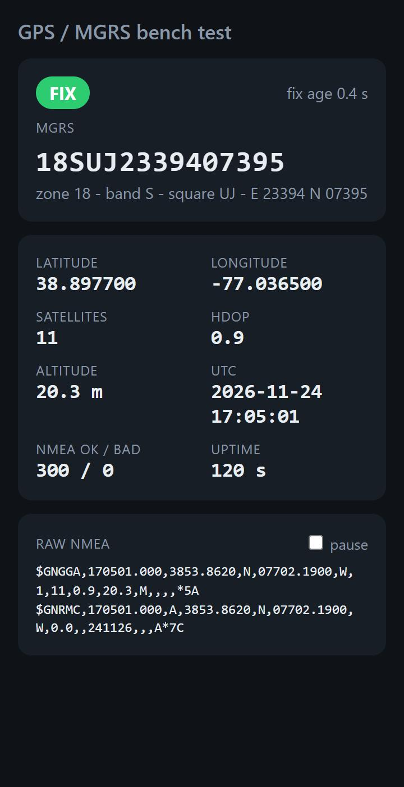

# GPS_WiFi_Bench_Test

Field check for the GPS + MGRS path with no computer. The board starts its own Wi-Fi access point and serves a status page to a phone.

  
  

*Left: XIAO ESP32-S3 + ATGM336H bench setup. Right: the status page (demo data at a public landmark). Tested outdoors on an iPhone with a fix on 11 satellites.*

## Use
1. Wire the GPS (9600 baud NMEA). Defaults: C3 GPS TX to GPIO20 (D7), GPS RX to GPIO21 (D6); S3 GPS TX to GPIO44 (D7), GPS RX to GPIO43 (D6). The sketch picks the pair from the build target.
2. Build and upload (libraries: TinyGPSPlus, local `..\MGRS`). On an S3 use `esp32:esp32:XIAO_ESP32S3`, on a C3 `esp32:esp32:XIAO_ESP32C3`.
3. Power from USB or a power bank, take the antenna outside.
4. On a phone join `gps-bench` (password in the sketch, change it), open `http://192.168.4.1`.

## Page
- FIX / NO FIX badge and fix age. "no NMEA - check wiring" if nothing arrives from the GPS.
- MGRS string from the library, split into zone, band, square, easting, northing.
- Latitude, longitude, altitude, UTC, satellites, HDOP, NMEA checksum ok/bad counts, uptime.
- Raw NMEA stream (last 24 lines, pausable).
- Endpoint `/data` returns the same as JSON.

## Notes
- No router, credentials or `secrets.h`. Nothing is stored; the position exists only in RAM and on the phone screen.
- The page is open to anyone who knows the AP password, so don't leave it running near a fixed location.
- The serial monitor (115200) prints the AP address on boot.
- Verified on a XIAO ESP32-S3 + ATGM336H (2026-11-24): phone page loaded, fix with 11 satellites outdoors. C3 build not yet tested. See `tests\bench-xiao-esp32s3`.
