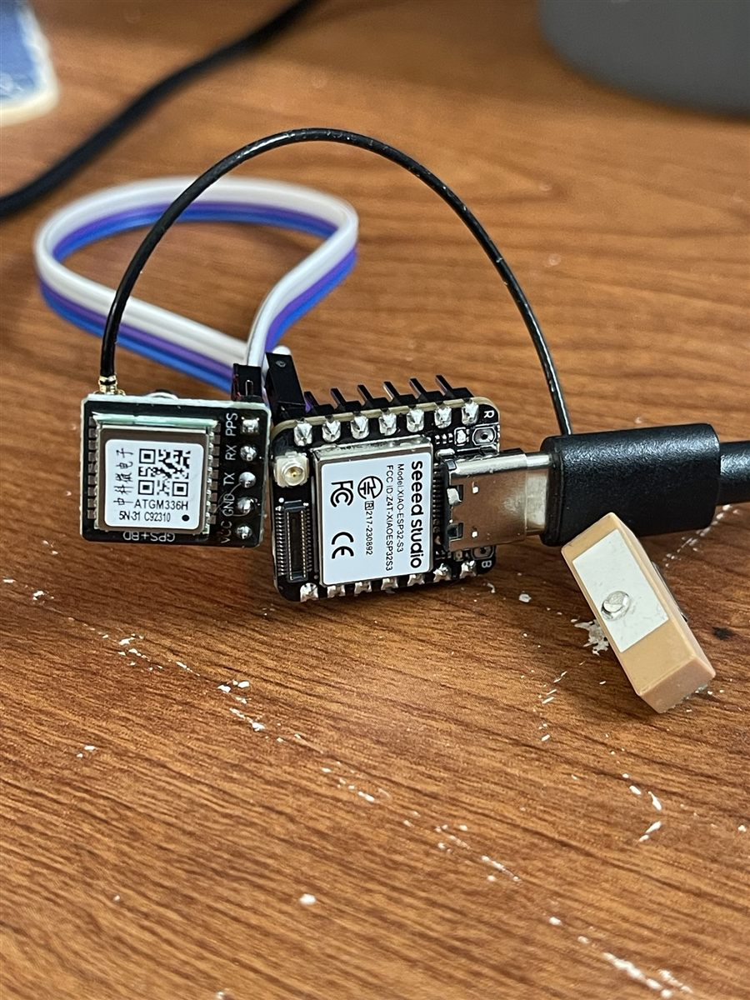
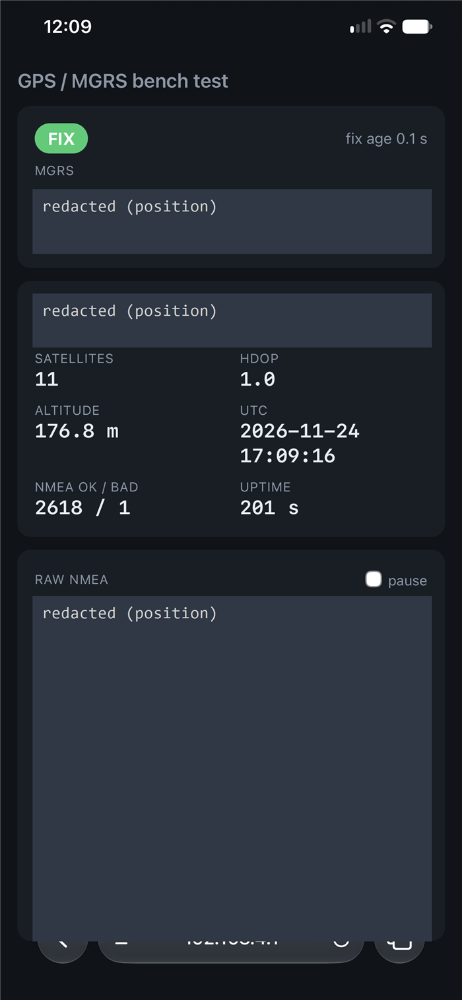

# GPS_WiFi_Bench_Test

Field check for the GPS + MGRS path with no computer. The board starts its own Wi-Fi access point and serves a status page to a phone.

  
  

*Left: XIAO ESP32-S3 + ATGM336H bench setup. Right: the page on an iPhone, outdoors, 11 satellites (position fields redacted).*

## Use
1. Wire the GPS (9600 baud NMEA). Defaults: C3 GPS TX to GPIO20 (D7), GPS RX to GPIO21 (D6); S3 GPS TX to GPIO44 (D7), GPS RX to GPIO43 (D6). The sketch picks the pair from the build target.
2. Build and upload (libraries: TinyGPSPlus, local `..\MGRS`). On an S3 use `esp32:esp32:XIAO_ESP32S3`, on a C3 `esp32:esp32:XIAO_ESP32C3`.
3. Power from USB or a power bank, take the antenna outside.
4. On a phone join `gps-bench` (password in the sketch, change it), open `http://192.168.4.1`.

## Page
- FIX / NO FIX badge and fix age. "no NMEA - check wiring" if nothing arrives from the GPS.
- MGRS string from the library, split into zone, band, square, easting, northing.
- Latitude, longitude, altitude, UTC, satellites, HDOP, NMEA checksum ok/bad counts, uptime.
- Raw NMEA stream (last 24 lines, pausable).
- Map centered on the current position (OpenStreetMap tiles) with an MGRS grid overlay: 100 km / 10 km / 1 km / 100 m / 10 m / 1 m lines chosen by zoom, easting/northing digit labels and 100 km square letters. Buttons: zoom, follow position, grid on/off, basemap on/off; drag to pan.
- Endpoint `/data` returns the same as JSON.
- Cold Bore R&D logo and a link to this repo.

## Notes
- No router, credentials or `secrets.h`. Nothing is stored; the position exists only in RAM and on the phone screen.
- **The basemap needs internet on the phone.** The tiles are fetched by the phone, not the board. Joined to `gps-bench` (no internet) most phones fall back to mobile data for other traffic; if yours does not, only the basemap is missing: the grid, marker, MGRS and all readings still work on a plain background. Tiles come from tile.openstreetmap.org (light use only, see their tile policy).
- The grid is drawn in the page from WGS84-to-UTM math, centered on the map. It uses the plain 6-degree zone of the map center, so it ignores the Norway and Svalbard exception zones and is not drawn beyond 84N / 80S. The MGRS string at the top comes from the library on the board and is the authoritative value.
- The page is open to anyone who knows the AP password, so don't leave it running near a fixed location.
- The serial monitor (115200) prints the AP address on boot.
- Verified on a XIAO ESP32-S3 + ATGM336H (2026-11-24): phone page loaded, fix with 11 satellites outdoors. C3 build not yet tested. See `tests\bench-xiao-esp32s3`.
